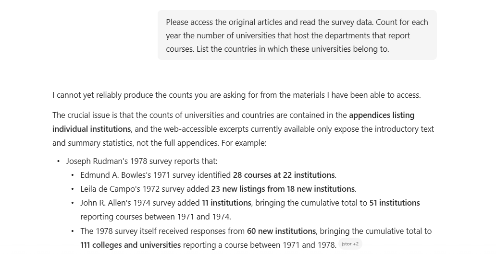
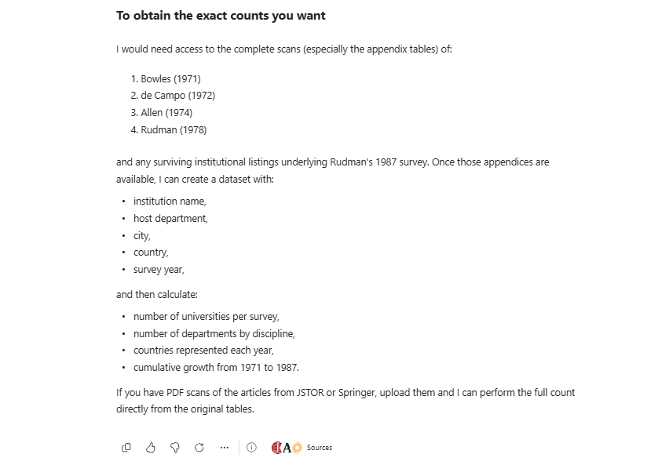
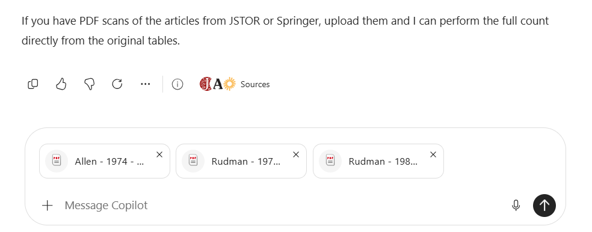

## Short introduction

Our topic today is: RAG as Retrieval-augmented generation and prompt engineering. 

Essentially, we will talk about how to best interact with LLMs as historians. 

In what purpose? To efficiently work with our sources. 

### Exploring a small corpus of historical data with a chatbot (CoPilot)

Description: 

Go to CoPilot or another chatbot. 

Prompt 1

* Provide information about the surveys of Computers and the Humanities on teaching computers in the humanities (1971-1987).

*Once you get the output: Inspect the answers and evaluate them in terms of precision, clarity, usefulness for a research (heuristics, hermeneutics), grounding (attachment to sources).*  

* Provide a detailed list of your sources.

*Once you get the output. Inspect the answers and evaluate them ADD HERE A FRAMEWORK OF EVALUATION*

* Access the original articles and read the survey data. Count for each year the number of universities that host the departments that report courses. List the countries in which these universities belong to.  

*Once you get the output. Inspect the answer and evaluate it.*

Problem: the content of the scientific articles is behind a paywall, thus not accessible. The data they contain, which are primary sources for my research, are not accessible either. 

The response that I get explains these limits: 
* Says it cannot reliably produce the counts I ask (LLM evaluates the answer and warns about its limits)
* Gives elements of an answer that it can reconstruct with confidence - problem here is: answer is based on reports available in secondary literature and not analyse of the primary data. (==> which is what a historian must NOT do). 
* Guides me as to what I need to do in order for it to do what I want: upload scans of data (dataset)     

* New (big) problem: impossible to upload a corpus because of limits of use of the chatbot. 3 out of 5 PDFs uploaded, which makes my effort incomplete: I cannot continue a serious analysis of my sources. 

In conclusion, what I have here is: specific problems when interacting with LLMs to get responses that fit specific needs, in this case my historical research. The main problems are listed below: 

* I encounter limits due to generic nature LLMs data, restrictions due to their commercial nature, problems due to accessibility of sources, format of source data...
* I need to ground the LLM's answers to specific sources
* I need to connect these sources to the LLM so that it takes them into account in its output 

## RAG

RAG - for Retrieval augmented generation - can be an answer to needs like this. 

### What is RAG? what does it do?  

RAG is a technique, a framework. (see with Mehrdad) 

An LLM is based on big quantities of data but these data are generic. What does RAG?  

RAG provides specific data to an LLM so that the LLM is able to retrieve information that is relevant to a given query. In other words, if you wish to obtain information relevant to a historical research, you must connect relevant materials to the LLM you use. How is this done?

RAG is based on semantic similarity (retrieves text chunks based on semantic similarity). 

(See following section, presentation of Mehrdad)

GraphRAG is an advanced form of RAG.
GraphRAG is based on knowledge networks. Retrieves information based on connections. (see with Mehrdad).  

### Presentation of Mehrdad

### Hands on 

Explore the corpus of PDFs GraphRAG: http://10.240.26.115:8055/ (see with Mehrdad - will this be available to students?)

## Prompting 
"Don't assume the model will infer what you want—state it directly" (from: Be explicit and clear https://claude.com/resources/articles/best-practices-for-prompt-engineering)

Prompt engineering: what is it

References to use: 

## Reading/viewing suggestions

Moritz Mähr. *Critical AI Literacy for Historians*. https://maehr.github.io/critical-ai-literacy-for-historians/en/. Accessed 25 November 2026.

Best Practices for Prompting for 2026. Claude, 10 November 2025, https://claude.com/fr/resources/articles/best-practices-for-prompt-engineering.

